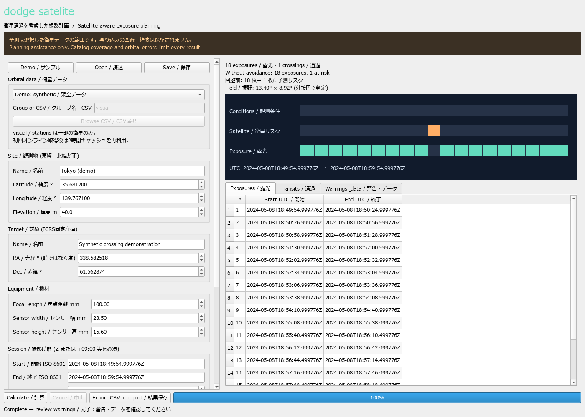

# dodge satelite 0.2.0

[](https://github.com/Aoi-Morio/dodge-satelite/actions/workflows/ci.yml)

[English](README.md) · [アルゴリズム・制約](docs/ALGORITHM.md) · [公開手順](docs/RELEASING.md)

[GitHubリポジトリ](https://github.com/Aoi-Morio/dodge-satelite) · [Release一覧](https://github.com/Aoi-Morio/dodge-satelite/releases)

天体撮影の視野を横切る人工衛星を予測し、通過時間を避けた露光計画を作るWindows向けOSSです。観測地、対象の座標、カメラと望遠鏡の寸法から計算し、タイムラインとCSVで確認できます。

**N.I.N.A.向けの実験版プラグイン「dodge satelite」もあります。** NINA 3.2の高度なシーケンサーで、
予測した露光枠を待ってからLIGHT撮影を行います。[導入・使用方法](nina/README.ja.md)を参照してください。
デスクトップ版とは別配布です。公式プラグインマネージャーへの掲載は未申請です。



**v0.2.0は実験的な撮影計画支援ソフトです。実写による精度検証は未実施で、衛星の写り込み回避を保証しません。** 緑色の露光枠は提案時間であり、「衛星が写らないことを確認済み」という意味ではありません。選択したデータに含まれない衛星は予測できません。

## Windowsで試す

実験版 [v0.2.0 Release](https://github.com/Aoi-Morio/dodge-satelite/releases/tag/v0.2.0) から [Windows x64版ZIPをダウンロード](https://github.com/Aoi-Morio/dodge-satelite/releases/download/v0.2.0/Dodge-Satelite-0.2.0-windows-x64.zip)できます。

実行ファイル版は `Dodge-Satelite` フォルダー全体を展開し、`Dodge-Satelite-GUI.exe` を開きます。`_internal` には実行時に必要なライブラリがありますので、EXEだけを移動しないでください。Pythonのインストールや管理者権限は不要です。実行ファイルは未署名です。

ソースから起動する場合は、64bitのPython 3.12以降を用意してPowerShellで実行します。ローカルでの動作確認はPython 3.12で行っています。

```powershell
py -3.12 -m venv .venv
.\.venv\Scripts\python.exe -m pip install -e ".[dev]"
.\.venv\Scripts\python.exe -m dodge_satelite gui
```

起動時は**架空の衛星・過去の日付によるサンプル**が読み込まれます。「Calculate / 計算」で通過を1件検出し、露光の配置を確認できます。「Export CSV + report / 結果保存」で結果を保存します。サンプルを今夜の予測として使用しないでください。

## 実際の計画を作る

1. 観測地の緯度・経度・標高を入力します。北緯・東経が正です。
2. 対象のICRS赤経・赤緯を**度単位**で入力します。赤経の「時」は15倍して度に変換します。対象名から座標を取得する機能はありません。
3. 焦点距離、センサーの幅と高さをmmで入力します。
4. 開始・終了時刻を、`2026-10-14T21:00:00+09:00` のように時差付きで入力します。`Z` はUTCです。時差なしの入力は拒否します。**結果とCSVはすべてUTC**です。
5. 衛星データを選びます。オンライン取得はCelesTrakのグループ名、ローカル読込はGP/OMM形式のCSVを使用します。TLEの直接読込は未対応です。
6. 露光・読出し時間、薄明条件、対象高度、時間・角度の余裕を設定し、計算します。
7. 「Warnings & data / 警告・データ」で元期と取得日時を確認し、計画を保存します。

プロファイルはJSONで保存・再読込できます。データ源の選択はプロファイルに保存されないため、読み込み後に確認してください。入力を変更すると結果の保存が無効になり、再計算が必要です。計算中は進捗表示と中止操作が利用できます。中止・終了は現在の計算または通信処理が戻った時点で反映されます。

## CLI

仮想環境を有効にした場合は `dodge-satelite`、有効にしていない場合は仮想環境のPythonで `-m dodge_satelite` を使います。実行ファイル版は `dodge-satelite.exe` です。

```powershell
dodge-satelite demo --out reports/demo
dodge-satelite fetch --group visual
dodge-satelite plan examples/observation.json --group visual --out reports/tonight
dodge-satelite plan examples/observation.json --group visual --offline --out reports/offline
dodge-satelite plan examples/observation.json --catalog my-satellites.csv --out reports/local
```

`examples/observation.json` は入力例です。**実行前に日時・場所・対象・機材を修正してください。** `visual` と `stations` は衛星全体の一部分です。特に `stations` で結果がゼロでも、他の衛星が通過しないことは示しません。`active` などの大きなカタログでは処理量制限に達する場合があります。時間範囲を短くするか、目的に合わせて作成したCSVを使ってください。衛星を黙って間引く処理はありません。

`--cache-dir` でキャッシュ先を指定できます。`--offline` はCelesTrakの既存キャッシュだけを使います。正常終了は0、入力・計算エラーは2です。対象衛星の伝播計算が1件でも失敗した場合、部分的な計画を正常結果として出力せず中止します。

## データの鮮度

- CelesTrakへのオンライン取得は利用者の操作で行い、同じグループへの再要求は**最低2時間**空けます。失敗時の自動再試行やリダイレクト追従は行いません。
- 取得データを検証してからキャッシュを置換します。同じキャッシュ・グループへの並行取得をロックします。
- 更新に失敗した際に既存キャッシュを使う場合は **STALE CACHE FALLBACK** と表示します。オフラインでも古い取得日時を警告します。
- **取得日時と軌道要素の元期は別です。** 各衛星の元期から観測開始・終了までの最大絶対日数差を記録します。既定の7日警告は目安であり、7日以内の精度を保証するものではありません。
- ローカルCSVの取得日時は不明と表示します。再現に必要な元CSVは利用者が保管してください。レポートにはハッシュと元期を記録しますが、CSV本体は含めません。
- `catalog_sha256` は解析用UTF-8テキストのハッシュです。BOM除去・ローカル改行正規化のため、元ファイルをOSで計算したハッシュとは異なる場合があります。
- Windowsの既定保存先は `%LOCALAPPDATA%\DodgeSatelite\cache` です。異常終了で `.lock` が残った場合は、全インスタンスを閉じてから該当ロックのみ削除します。サービスのエラー時に履歴を消して連続要求しないでください。

観測地・対象を外部に送信することはなく、テレメトリーもありません。惑星暦やIERSデータの裏での自動ダウンロードは行いません。データ利用は [CelesTrak利用方針](https://celestrak.org/usage-policy.php) と [GP形式の説明](https://celestrak.org/NORAD/documentation/gp-data-formats.php) に従ってください。

## 判定方法と限界

Skyfield/SGP4で観測地から見た衛星方向を計算します。センサーの矩形を外接円で覆い、その円に角度の余裕を加えて判定するため、カメラ回転角に依存しない反面、実際の矩形外の通過も避ける場合があります。

既定の時間間隔は0.5秒です。サンプル点だけでなく隣接方向間の線分を調べ、交差した時間区間全体を塞いだうえで前後3秒を加えます。ただし、**軌道の曲率や予測誤差を厳密に包含する保証ではありません**。余裕の秒数・角度に統計的な信頼水準はありません。

太陽位置はAstropyの内蔵暦を使い、衛星から見た球形地球と太陽の角半径から本影を判定します。半影は日照リスクとして扱います。反射率、姿勢、フレア、等級の予測はありません。日照のみのチェックを外すと、本影内も含む全通過を回避します。

対象の最低高度と太陽の最大高度も制約にします。既定値は対象25°以上・太陽−12°以下で、サンプルは実演用に異なる値を使います。大気差、地形、天候、光学歪み、追尾誤差、対象の固有運動、月・惑星等の移動対象には対応していません。固定恒星座標と幾何学的な方向を用い、年周光行差や光行時間の補正も精密な撮像用途として検証していません。

露光は固定長・読出し時間固定の条件で、禁止区間を避けて最も早い時刻から配置します。この条件内での枚数最大化です。複数対象、可変露光、S/N、望遠鏡の移動や機材制御は最適化しません。「回避前のリスク枚数」は計算上の比較であり、実写で確認した汚染枚数ではありません。

v0.1の上限は1セッション24時間、35万時間サンプル、衛星数×時間サンプル数が5,000万以下です。上限内でも処理時間・メモリーは増加します。未登録・非公開衛星、マヌーバー、古い要素、サンプル間の軌道変化により見逃しがあり得ます。実測による精度の主張は行いません。

## 保存されるもの

| ファイル | 内容 |
|---|---|
| `exposures.csv` | UTC露光開始・終了・時間、「写り込みなし未保証」の状態 |
| `transits.csv` | 衛星番号・名前、通過区間、日照方針、元期と余裕時間 |
| `blocked.csv` | 観測条件・衛星リスクによる禁止区間と理由 |
| `report.json` | 入力のスナップショット、警告、元期、ハッシュ、計算結果 |
| `timeline.svg` | 共有可能な撮影タイムライン |

同名ファイルは上書きされます。CSVはExcelで読みやすいUTF-8 BOM付きです。小数6桁の時刻表示は入力値を保つためで、マイクロ秒精度を示していません。

## 開発・公開

```powershell
python -m pip install -e ".[dev]"
python -m pytest -q
python -m ruff check .
python -m ruff format --check .
python -m build
python scripts/build_windows.py
```

`constraints-windows-py312.txt` にはローカル検証時の依存バージョンを記録します。GitHub上でWindowsのPython 3.12/3.13とUbuntuの3.12のテスト、およびWindowsビルドが成功しています。検証対象コミットと実行結果は [検証記録](docs/VALIDATION.md)、今後の観測実験は [実写評価計画](docs/EVALUATION.md) を参照してください。

オリジナルのコード・架空サンプルは [MITライセンス](LICENSE) です。依存ライブラリはそれぞれのライセンスを保持します。Qt/PySide6のLGPL等については [第三者ライセンス](THIRD_PARTY_NOTICES.md) を参照してください。

GitHubリポジトリ作成・push・タグ・Releaseの公開は [公開手順](docs/RELEASING.md) に分離しています。ビルドしても外部公開されません。
