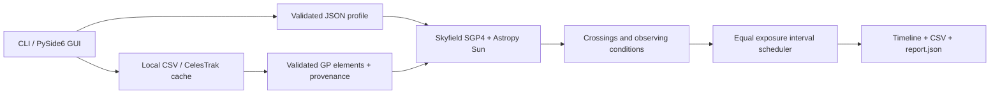

# Design and numerical assumptions

The practical contribution is one reproducible workflow linking imaging equipment,
catalog provenance, satellite risk intervals and exposure scheduling. This release
does not claim a new orbit propagator, a research novelty result or superiority
over existing satellite trackers. It reuses established scientific libraries.

## Modules

`models.py`: immutable validated site, target, equipment and session.
`catalog.py`: GP parser, nine-digit catalog identifiers, validated atomic cache,
request cooldown and per-group lock. SGP4 internally uses a placeholder ID for
numbers outside its Alpha-5 range; full identifiers remain on each satellite and
in every report. The identifier does not affect orbital propagation.
`predict.py`: geometry and sampled intervals.
`schedule.py`: interval union/complement and greedy maximum-count schedule.
`export.py`: UTC outputs and provenance.
`gui.py`: data entry, worker lifecycle, cancellation and presentation.

## Geometry

1. Skyfield's bundled timescale supplies UTC/TT/UT1 and Earth orientation; no IERS
   download occurs. SGP4 propagates the GP mean elements, then Skyfield converts its
   TEME output to a geocentric celestial orientation and subtracts a WGS84 observer.
2. The target is a fixed geometric ICRS direction. Proper motion, annual/diurnal
   aberration, light-time and refraction are not applied as a precision imaging
   pointing model. Supply consistent catalog coordinates and allow margins.
3. For sensor width `w`, height `h`, focal length `f`, circular half-angle is
   `atan(hypot(w,h)/(2*f))`. Add the user's angular margin. A circular enclosure
   allows any camera position angle but overestimates a rectangular footprint.
4. Normalize satellite-observer vectors. For each adjacent pair, find the closest
   point on their straight 3-D chord to the target unit vector. Test distance
   against `2*sin(radius/2)`. Chords inside the unit sphere are conservative
   relative to the interpolated great-circle track but are not guaranteed bounds
   on the real curved trajectory. RA wrap and the celestial poles have no
   coordinate singularity in this calculation.
5. Require nonnegative satellite altitude at at least one endpoint. In sunlit-only
   mode, at least one endpoint must be outside full umbra. Full intersected sample
   cells are retained, merged and padded. Rapid excursions in altitude or shadow
   between samples can be missed. No probabilistic uncertainty propagation occurs.
6. Astropy's built-in Sun and Earth barycentric vectors provide the geometric Sun
   direction. Eclipse uses a spherical Earth radius 6378.137 km, Sun radius
   695700 km and apparent disk angular separation from the satellite. Only fully
   occulted sunlight is excluded; penumbra counts as lit. Earth's atmosphere and
   oblateness are omitted in the shadow model. This can affect grazing eclipses.
7. Local zenith projects the fixed target and geometric Sun directions into
   altitude. A full sample cell is unavailable if either endpoint violates the
   minimum target or maximum Sun altitude. Sub-sample extrema are not rigorously
   bounded. Skyfield time tables can age; update dependencies and investigate
   Earth-orientation needs before high-precision use.

Sample-grid endpoint spacing is at most the requested step, with the final point
exactly at session end. Transit CSV times are full grid-cell extents, not fitted
physical ingress/egress times. Number formatting does not express accuracy.

## Scheduling objective

Union the observing-condition and padded satellite blocks; take their complement
inside the session. Place every fixed-duration exposure at the first legal time,
then enforce a fixed readout delay before the next exposure. Readout may fall
inside a blocked interval and after the final exposure. Intervals are half-open
for overlap comparisons.

For identical exposure durations and readout delays, any feasible first exposure
can move earlier to the greedy position without delaying subsequent exposures.
Induction yields a maximum-count schedule under **these computed constraints**.
Tests compare it with exhaustive enumeration of small integer-time cases.
This proof says nothing about actual satellite visibility or unmodeled constraints.

## Scope and workload

Single site and fixed target; up to 24 hours, 350,000 intervals plus endpoint,
30,000 catalog entries and 50 million satellite-time samples. The product limit
is a resource guard, not a performance SLA. Arrays scale with session samples;
satellites are processed one at a time. Cancellation is cooperative between major
operations/satellites. Request timeout is 30 seconds per socket operation. No
rigorous worst-case cancellation latency is promised for a slow streaming server.

## Primary references

- [Skyfield Earth satellites](https://rhodesmill.org/skyfield/earth-satellites.html)
- [Skyfield time tables](https://rhodesmill.org/skyfield/time.html)
- [SGP4 implementation and validation](https://github.com/brandon-rhodes/python-sgp4)
- [Vallado et al., Revisiting Spacetrack Report #3](https://celestrak.org/publications/AIAA/2006-6753/)
- [Astropy built-in barycentric positions](https://docs.astropy.org/en/stable/api/astropy.coordinates.get_body_barycentric.html)
- [CelesTrak GP formats](https://celestrak.org/NORAD/documentation/gp-data-formats.php)
- [CelesTrak usage policy](https://celestrak.org/usage-policy.php)

Library regression/consistency checks are not independent on-sky validation.
